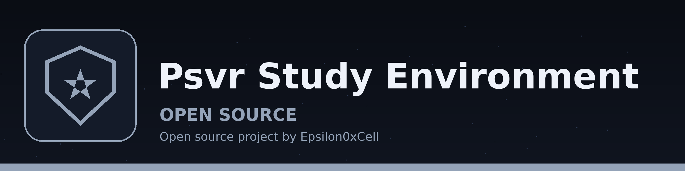

# PSVR-Study-Environment

Custom PSVR study environment mp4 generator.

## The problem

PSVR has no study environments. This project lets you build your own: it
takes a 360 VR video to use as the room and a normal video of the material
you want to study, and produces one mp4 with the study video playing in
the center of the 360 video. Put the result on a USB stick and play it in
the PSVR media player with the VR option ticked on. You can pause, play,
and fast-forward the study video as needed.

The limit, set by the PlayStation side, is that you cannot actively work
on assignments this way. You record your desktop beforehand and study the
recording, so this is a study environment, not a workspace.

## What the script does

`study-generate.sh` runs in the folder it is invoked from and:

1. Checks that `ffmpeg` and `ffprobe` are installed, and that both input
   files exist. A missing file is reported as not found; a file that
   ffprobe cannot read is reported as corrupted. Either problem stops
   the script with exit code 1 before any conversion runs.
2. Probes both inputs with ffprobe to check their integrity.
3. Runs one ffmpeg pass that overlays the study video, scaled to
   640x360, in the center of the 360 video, then scales the result to
   1920x1080 at 60 fps, H.264 (baseline profile, level 4.0) at 4M
   bitrate, with the background video's audio copied through when it
   has any.
4. The background is looped twice extra and the overlay three times
   extra inside ffmpeg, so the output runs about three times as long
   as the background video. For longer sessions, loop the output again
   with the PlayStation media player's repeat function, in its own
   folder.

Verified with ffmpeg 8.1: a 2 second 640x320 test background and a 1
second test overlay produced a 1920x1080 output of about 6 seconds
with the expected video and audio streams.

## Requirements

- Bash
- ffmpeg and ffprobe (on PATH)

## Usage

Name your files exactly as below, put them in one folder with the
script, and run it from that folder. The script takes no arguments and
has no menu.

```
vr.mp4        the 360 VR environment video
non360.mp4    the study video to place in the center
```

```bash
chmod +x study-generate.sh
./study-generate.sh
```

The result is written to `output.mp4` in the same folder.

## Notes on preparing the videos

- Find a 360 VR study environment on YouTube, download it (for example
  with youtube-dl-gui), and record the material you want to study as an
  mp4. Short videos (the original notes suggest 4 to 20 minutes) work
  best because you will loop them.
- Recording with Kazam for PlayStation compatibility: in File >
  Preferences > Screencast, use h264 at 60 fps. PlayStation playback
  needs h264 encoding, above 30 fps, and under 4 GB per file because of
  the FAT32 file system.
- HandBrake (https://handbrake.fr/) with the PlayStation 1080p surround
  sound preset also works for converting a recording. YouTube VR videos
  are usually downloaded as webm at the highest quality, which is why a
  conversion step is often needed first.

## Semi-VR alternative

For an active (interactive) setup instead: update the PSVR firmware,
turn on bigscreen / cinematic mode, hook the PSVR up to the PC, and work
with keyboard and mouse while adjusting volume on the headset. The
trade-off is that you get a giant movie theatre screen, not a 360
environment.

## Not implemented

The following were ideas in the original notes and are not in the
script: an input menu, SRS, a loci memory palace, automatic YouTube
fetching, automatic resolution and encoding choices, custom music, a
desktop recording menu, and prompts about cutting the video shorter.
The script does exactly the steps listed under "What the script does"
and nothing else.

## Thanks to

- https://aur.archlinux.org/packages/kazam
- https://handbrake.fr/
- https://www.youtube.com/@AmbientRenders/videos
- https://stackoverflow.com/questions/68389529/overlay-video-on-video-in-moviepy
- https://www.oodlestechnologies.com/blogs/PICTURE-IN-PICTURE-effect-using-FFMPEG/
- https://superuser.com/questions/1093507/loop-a-video-overlay-with-ffmpeg
- https://superuser.com/questions/1689522/ffmpeg-how-to-make-the-overlay-loop-till-the-end-of-the-main-video

## License

MIT. See LICENSE.
